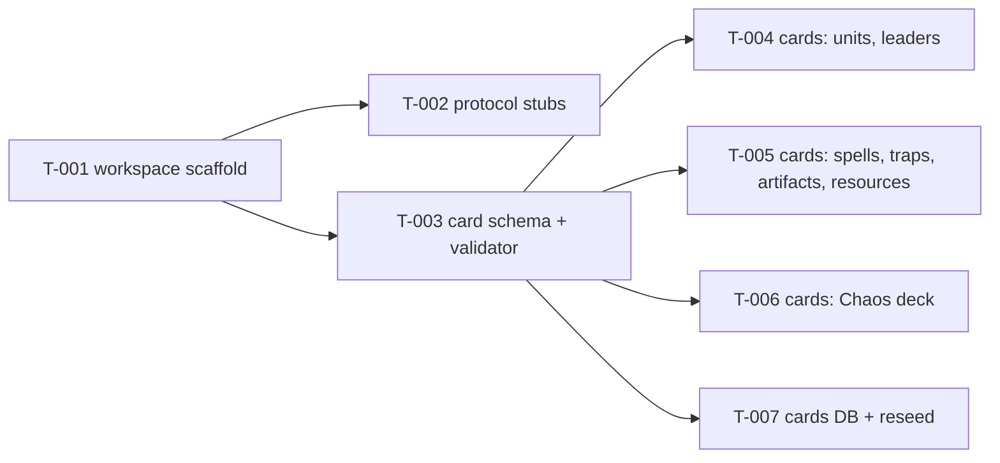
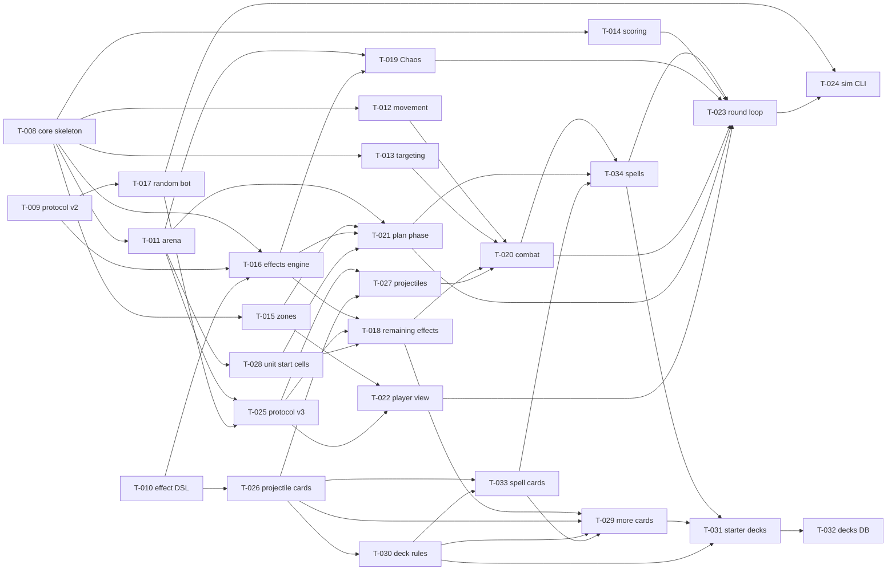
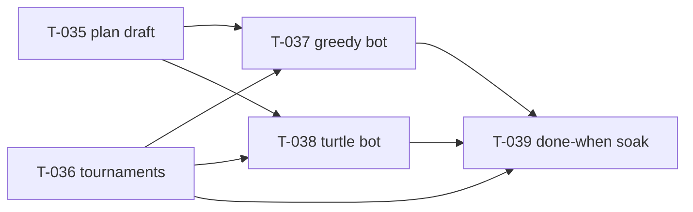
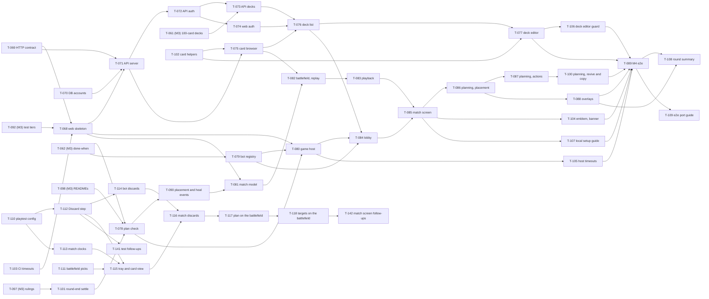
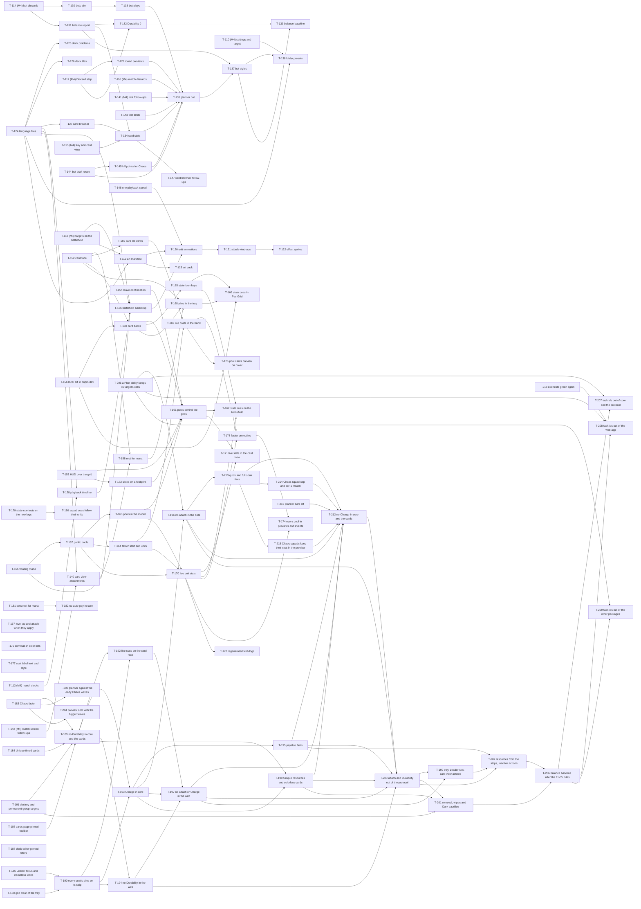

# Tasks

A task card is a pre-planned unit of agent work: **one card = one worker = one branch = one PR**. The card's `scope` lists the only paths the worker may change. `crew pr` refuses to push a branch that changes anything else. Cards are merged to `main` before work starts, because workers and `crew pr` read them from `main`.

This folder holds the plan. What's merged comes from git (WORKFLOW.md D16). What's in flight (`todo`, `working`, `review`, …) lives in Redis (crew's COMMS.md). `crew status` shows both.

## Card format

Copy [TEMPLATE.md](TEMPLATE.md) to `docs/tasks/<milestone>/T-NNN-<slug>.md`.

| Front matter | Meaning |
| --- | --- |
| `id` | `T-NNN`, unique across milestones, never reused |
| `title` | Short and human-readable, about 40 characters at most. It's also the PR title: `T-NNN <title>`. |
| `milestone` | `M0`, `M1`, … |
| `depends_on` | Tasks that must be `merged` before this one starts |
| `branch` | `agent/T-NNN-<slug>`, where the slug matches the file name |
| `model` | Optional: `opus`, `sonnet` or `haiku`, the worker's model. Default `sonnet` (D17). |
| `effort` | Optional: `low`, `medium`, `high`, `xhigh` or `max`. Default `medium`. |
| `scope` | A block list of globs, one per line, saying which paths may change. `dir/**` covers everything below `dir`; a plain path covers one file. `pnpm-lock.yaml` is always allowed. |
| `context` | A block list of what the worker must read: a file (`docs/CORE.md`) or one section of it (`docs/RULES.md#Combat`, matched by the start of the heading). `crew context T-NNN` prints the card followed by all of them. |

Body sections: Goal · Interfaces · Deliverables · Acceptance · Out of scope · Notes. Older cards have a Read first section instead of `context:`.

## Planning rules (for the lead)

1. **Tasks that run at the same time have disjoint scopes.** Group them into waves.
2. **Shared contracts get their own task, merged before their users.** Shared contracts are the protocol messages, the card schema, the DB schema and the root config.
3. **One migration task at a time.** Only one task at a time may touch `packages/db/migrations/**`, because generated migration numbers collide.
4. **Root files belong to dedicated tasks only.** That means `package.json`, `pnpm-workspace.yaml`, `tsconfig.base.json`, `eslint.config.*` and `.github/**`. T-001 sets up the root scripts in advance, so package tasks never need to touch them.
5. **Size: a PR a human can review in about 15 minutes**, tests included, and about 60–100 worker steps. `crew tokens` shows what each task took; split a card that would clearly take more.
6. **Acceptance criteria are things you can run or check, not adjectives.** Workers run headless, so each criterion is a command or a check of its output: no manual steps in a browser. Component tests and the Playwright specs (`pnpm test:e2e`) check what the browser shows.
7. **Put known ambiguities and their default answers in the card's Notes**, so parallel workers don't each ask the same question.
8. **Hand the worker its context** (D17). List under `context:` exactly the sections it must read, not whole docs, and put the exact names it will use in Interfaces: signatures, types, file paths, event names. Every search a worker doesn't have to make saves steps, and every step re-reads its whole context.
9. **Pick the model.** Leave `sonnet`/`medium` for most tasks. Use `opus` (and `high` effort if needed) for tasks that need judgment: core rules, shared contracts, tricky algorithms. Use `haiku` for mechanical ones: data files, renames, docs that follow a fixed pattern.
10. **Write test filters without `--`.** `pnpm --filter @chaosgrid/web test planning CardView` runs the files whose paths match. After `--`, Vitest runs every file.
11. **No two paths that differ only in case.** macOS's file system ignores case, so a card never names a file beside one that differs from it only in case: T-125's `quickAdd.ts` next to `QuickAdd.tsx` broke TypeScript (TS1261), and it became `matchCard.ts`. The same goes for ignore patterns: `.gitignore`'s `Art/` also hid `apps/web/src/art/` until it became `/Art/` (2026-11-02).

## M0 — Skeleton

Done when `pnpm test` is green, `pnpm cards:validate` rejects a malformed card, and a second `pnpm db:seed` in a row changes nothing ([PLAN.md](../PLAN.md) › Milestones).

| Wave | Task | Depends on | Scope (shorthand; cards list one glob per line, and braces don't work there) |
| --- | --- | --- | --- |
| 1 | [T-001 Workspace scaffold](M0/T-001-workspace-scaffold.md) | — | root config files |
| 2 | [T-002 Protocol stubs](M0/T-002-protocol-stubs.md) | T-001 | `packages/protocol/**` |
| 2 | [T-003 Card schema and validator](M0/T-003-card-schema.md) | T-001 | `packages/cards/**` |
| 3 | [T-004 Sample cards: units and leaders](M0/T-004-cards-units-leaders.md) | T-003 | `packages/cards/data/{units,leaders}/**` |
| 3 | [T-005 Sample cards: spells, traps, artifacts, resources](M0/T-005-cards-spells-resources.md) | T-003 | `packages/cards/data/{rituals,sorceries,traps,artifacts,enchantments,resources}/**` |
| 3 | [T-006 Sample cards: Chaos deck](M0/T-006-cards-chaos.md) | T-003 | `packages/cards/data/chaos/**` |
| 3 | [T-007 Cards database and reseed](M0/T-007-cards-db.md) | T-003 | `packages/db/**` |

Wave 3 starts as soon as T-003 is merged, even if T-002 is still running. The parallelism goes 1 → 2 → 4 workers.

## M1 — Core simulation, headless

Done when 100 headless games between 4 random-plan bots finish without errors, and golden-file tests lock the event stream of two scripted rounds ([PLAN.md](../PLAN.md) › Milestones).

Most of M1 is one package, `packages/core`, so the cards share a set of conventions: `docs/CORE.md`, in the code repo. It covers the module layout, state slices, ids, coordinates, events, and defaults for open rules questions. T-008 builds the skeleton, and after that each module task owns one folder, so up to seven tasks run at once. T-026 and T-029 to T-032 work on cards, decks and the DB, next to core.

The graph leaves out edges that another path already implies (T-020 also needs T-011, T-016, T-025 and T-026; the cards list every dependency).

| Wave | Task | Depends on | Scope |
| --- | --- | --- | --- |
| 1 | [T-008 Core skeleton and state model](M1/T-008-core-skeleton.md) | T-002, T-003 | `packages/core/**` |
| 1 | [T-009 Protocol v2](M1/T-009-protocol-v2.md) | T-002 | `packages/protocol/**`, `docs/PROTOCOL.md` |
| 1 | [T-010 Effect DSL v1](M1/T-010-effect-dsl.md) | T-003 to T-006 | `packages/cards/**` |
| 2 | [T-011 Arena layout and placement](M1/T-011-arena.md) | T-008 | `packages/core/src/arena/**` |
| 2 | [T-012 Pathfinding and movement](M1/T-012-movement.md) | T-008 | `packages/core/src/movement/**` |
| 2 | [T-013 Targeting](M1/T-013-targeting.md) | T-008 | `packages/core/src/targeting/**` |
| 2 | [T-014 Scoring and winning](M1/T-014-scoring.md) | T-008 | `packages/core/src/scoring/**` |
| 2 | [T-015 Decks, hands and resources](M1/T-015-zones.md) | T-008 | `packages/core/src/zones/**` |
| 2 | [T-016 Effects engine](M1/T-016-effects-engine.md) | T-008, T-009, T-010 | `packages/core/src/effects/**` |
| 2 | [T-017 Random bot](M1/T-017-random-bot.md) | T-009 | `packages/bots/**` |
| 3 | [T-019 Chaos deck and Emblems](M1/T-019-chaos.md) | T-011, T-016 | `packages/core/src/chaos/**` |
| 3 | [T-025 Protocol v3](M1/T-025-arena-protocol.md) | T-009, T-011, T-017 | `packages/protocol/**`, `docs/PROTOCOL.md`, `packages/bots/test/fixtures/**` |
| 3 | [T-026 Projectiles in card data](M1/T-026-projectile-cards.md) | T-010 | `packages/cards/**`, plus five test card files in core and db |
| 3 | [T-028 Unit start cells](M1/T-028-start-cells.md) | T-011 | `packages/core/src/arena/**` |
| 4 | [T-018 Remaining effects and scripts](M1/T-018-effects-rest.md) | T-016, T-025, T-028 | `packages/core/src/effects/**` |
| 4 | [T-021 Plan phase](M1/T-021-plan-phase.md) | T-009, T-011, T-015, T-016, T-028 | `packages/core/src/plan/**` |
| 4 | [T-022 Player view](M1/T-022-player-view.md) | T-009, T-011, T-015, T-025 | `packages/core/src/view/**` |
| 4 | [T-027 Projectiles](M1/T-027-projectiles.md) | T-008, T-025, T-026 | `packages/core/src/projectiles/**`, plus slice and id registration in `packages/core/src/state/` and `modules.test.ts` |
| 4 | [T-030 Deck rules](M1/T-030-deck-rules.md) | T-026 | `packages/cards/src/deck/**`, `packages/cards/src/index.ts`, `packages/cards/README.md` |
| 5 | [T-020 Tick loop and combat](M1/T-020-combat.md) | T-011, T-012, T-013, T-016, T-018, T-025 to T-027 | `packages/core/src/combat/**` |
| 4 | [T-033 Spell classes in card data](M1/T-033-spell-cards.md) | T-026, T-030 | `packages/cards/**`, db's sorcery test fixtures |
| 5 | [T-029 More sample cards](M1/T-029-more-cards.md) | T-018, T-026, T-030, T-033 | `packages/cards/data/**`, plus the three tests that list sample cards |
| 6 | [T-034 Spells in protocol and core](M1/T-034-spells.md) | T-020, T-021, T-033 | `packages/protocol/**`, `packages/bots/**`, cards' schema, and core's `plan/`, `combat/`, `view/`, `effects/` |
| 7 | [T-023 Round loop and public API](M1/T-023-round-loop.md) | T-014, T-018 to T-022, T-025, T-028, T-034 | `packages/core/src/round/**` |
| 7 | [T-031 Starter decks](M1/T-031-starter-decks.md) | T-029, T-030, T-034 | `packages/cards/decks/**`, `packages/cards/src/node/**`, `packages/cards/README.md` |
| 8 | [T-024 Sim CLI and golden tests](M1/T-024-sim-cli.md) | T-017, T-023 | `tools/sim-cli/**` |
| 8 | [T-032 Decks database](M1/T-032-decks-db.md) | T-007, T-031 | `packages/db/**` |

Waves are a rough guide: a task can start as soon as its own dependencies merge (`crew status` lists them under "Can start now"). Each core module task can also write fixtures in `packages/core/test/fixtures/<module>/`.

## M2 — First bots

Done when the M2 bots are fit to be M4's opponents: at 2, 3 and 4 seats, with both deck sources, no game throws, tables of one bot get no rejected plan actions and rarely hit the round cap, and GreedyBot beats RandomBot in more than 65% of games ([PLAN.md](../PLAN.md) › M2). Win rates between bots are reported, not gated.

Both new bots would otherwise share `packages/bots/src/index.ts`, the README and RandomBot's bookkeeping. So T-035 extracts that bookkeeping into a shared `PlanDraft`, adds placement helpers, and registers both bots as stubs. After that each bot owns one file. T-036 adds tournaments to sim-cli at the same time, so the bot tasks can measure them. T-039 pins the done-when in a test and fixes what it finds in the bots.

| Wave | Task | Depends on | Model | Scope |
| --- | --- | --- | --- | --- |
| 1 | [T-035 Shared plan draft for bots](M2/T-035-plan-draft.md) | T-017 | opus | `packages/bots/**`, `tools/sim-cli/src/bots.ts` |
| 1 | [T-036 Bot tournaments in sim-cli](M2/T-036-tournament.md) | T-024 | sonnet | `tools/sim-cli/src/` (tournament, command, index), `tools/sim-cli/README.md` |
| 2 | [T-037 GreedyBot](M2/T-037-greedy-bot.md) | T-035, T-036 | sonnet | `packages/bots/src/greedy-bot*.ts`, its fixture |
| 2 | [T-038 TurtleBot](M2/T-038-turtle-bot.md) | T-035, T-036 | sonnet | `packages/bots/src/turtle-bot*.ts`, its fixture |
| 3 | [T-039 M2 done-when: bot soak](M2/T-039-m2-done-when.md) | T-036, T-037, T-038 | sonnet, high effort | the two bots, `packages/bots/README.md`, `tools/sim-cli/test/m2-done-when.test.ts`, `tools/sim-cli/README.md` |

## M3 — Rules v2

Done when the M2 bots still meet M2's bars on the new rules (4 seats on the new battlefield, 100-card decks in all five colors), every round's events form a valid timeline, and a golden round locks every new mechanic ([PLAN.md](../PLAN.md) › M3).

Nearly every rules task changes a shared contract and the same hub files: `PROTOCOL_VERSION` and docs/PROTOCOL.md, the card DSL and its README, core's tests and the golden rounds in `tools/sim-cli/test/golden/`. So they run one at a time, in this order: the renames, colors, Plan abilities and rest, card colors, traps, the timeline, ticks, the projectile speed cap, the battlefield, the prize, then the zone mechanics, the Light keywords, fear, copy and the snapshot's positions. The renames go first, so every later task and card uses the new names. The timeline goes before 100 ticks per second so the goldens never hold a `tick` event for every tick. The prize goes right after the battlefield, so every later effect gets its immunity guard. T-064 goes last: it moves Mirror Snare's and copy's nearest-squad rule into one helper, and it makes Chaos squads and tokens targetable, so it must come after both. T-063 (Unique cards and the 4-copy limit) touches only the cards package and the sim-cli deck generator, so it runs beside the timeline and ticks; the battlefield waits for it, since both edit the generator's package. Each task that changes a payload bumps `PROTOCOL_VERSION` by one, and each updates the goldens it changes, saying why in its PR.

The content tasks (T-054 to T-060) add card files only, so they run alongside the rules tasks. That is a stated exception to planning rule 1: their scopes, `packages/cards/data/**` and their own `packages/cards/test/sets/<set>.test.ts`, overlap the rules tasks' card edits, but they add new files and never change or delete existing ones, a duplicate id fails validation, and no rules task edits `packages/cards/test/sets/`. Each starts once the mechanics its cards use are merged. T-059 also waits for the Earth, Dark and Light sets, so every dual Leader can get a generated deck, and T-060 waits for copy, the last mechanic, and for Unique. T-061 then moves decks to 100 cards, and T-062 pins the done-when.

T-067 makes the spell class test in `packages/cards/src/spells.test.ts` check only the base set, so the content tasks' new spells don't break it. T-054 waits for it, and the later content tasks get it on their base. It runs in wave 4 beside T-043, a stated exception to rule 1 as well: T-043's `packages/cards/**` holds that file, but T-067 changes only its last `describe`.

T-091, T-092 and T-093 answer T-046's open questions, and they run side by side in wave 8, with disjoint scopes. T-091 caps projectile speed (D30). T-092 runs the perf tests alone and moves the whole-game soaks to `pnpm test:soak` and their own CI job (D31). T-093 writes down the rule for core's caches and adds a test that plays rounds with empty caches (D32). T-047 waits for all three, because it edits the protocol, core and the sim-cli tests. M4's T-068 waits for T-092, since both edit the root `package.json` and CI (planning rule 4).

Two follow-ups from M1 run at the end. T-065 (permanent and token events) comes after T-099, because both edit the protocol and `packages/core/src/**`. Its scope is disjoint from T-061's, because T-065 leaves `packages/core/test/fixtures/round/games.ts` to T-061. T-062 waits for T-065, since both edit the goldens. T-066 (core's deck fixture from the starter decks) needs T-061's decks, and it comes after T-065 because both edit `packages/core/src/**`. It runs beside T-097.

T-094 to T-098 come from the merged M3 tasks' open questions (2026-10-26). T-095 gives two slow sim-cli tests a timeout. It can start at once, and T-061 waits for it, since both edit those two test files. T-094 makes two checks in `packages/cards/src/dsl.test.ts` one-way, so a content task can add a card without editing that file. It waits for T-053, whose scope holds the file, and T-060 waits for it. T-096 breaks core's import cycles and adds a test that fails on a new one (D35). It runs beside T-094 right after T-053, and T-064 waits for it, because both edit `packages/core/src/**`. T-097 puts the 2026-10-26 rulings in core: an On death holds the early round ends, a Plan revive checks its filter, a grid is never wider than the Chaos Grid, and Plan hides the voids and points too (D34). It waits for T-065 and runs beside T-066, with disjoint scopes. T-062 waits for it, since both edit the goldens. T-098 brings the protocol and core READMEs up to date after T-097, beside T-062. M4's T-078 waits for it, since both edit those READMEs.

T-099 comes from T-060's handoff (2026-10-27). Fog of War's `noSpells` forbids defensive and offensive spells, but the bots can't see it, so the M2 soak has been red on `main` since T-060's merge. T-099 puts the rules that are on for a seat in that seat's snapshot, and the bots and their referee respect `noSpells`. It waits for T-064, whose scope holds all of T-099's, and runs beside T-061 with a disjoint scope. T-065 waits for it, since both edit the protocol and core.

```mermaid
graph LR
  T040["T-040 spells, discard pile"] --> T041["T-041 five colors"]
  T041 --> T042["T-042 Plan abilities, rest"]
  T042 --> T043["T-043 card colors"]
  T043 --> T044["T-044 static traps"]
  T044 --> T045["T-045 timeline"]
  T045 --> T046["T-046 100 ticks/s"]
  T046 --> T091["T-091 projectile speed cap"]
  T091 --> T047["T-047 battlefield"]
  T046 --> T092["T-092 test tiers"]
  T046 --> T093["T-093 cache guardrails"]
  T092 --> T047
  T093 --> T047
  T044 --> T063["T-063 Unique, 4 copies"]
  T063 --> T047
  T047 --> T048["T-048 prize"]
  T048 --> T049["T-049 banish, sacrifice"]
  T049 --> T050["T-050 dump, discard, revive"]
  T050 --> T051["T-051 Light keywords"]
  T051 --> T052["T-052 fear"]
  T052 --> T053["T-053 copy"]
  T042 --> T067["T-067 spells test, base only"]
  T042 --> T054["T-054 Earth set"]
  T067 --> T054
  T044 --> T055["T-055 Ember, Tide top-up"]
  T044 --> T056["T-056 colorless top-up"]
  T050 --> T057["T-057 Dark set"]
  T051 --> T058["T-058 Light set"]
  T054 --> T059["T-059 dual Leaders"]
  T057 --> T059
  T058 --> T059
  T053 --> T094["T-094 cards tests one-way"]
  T053 --> T060["T-060 rest, fear, copy, color cards"]
  T063 --> T060
  T094 --> T060
  T054 --> T061["T-061 100-card decks"]
  T055 --> T061
  T056 --> T061
  T057 --> T061
  T058 --> T061
  T059 --> T061
  T060 --> T061
  T095["T-095 sim-cli timeouts"] --> T061
  T053 --> T096["T-096 core import cycles"]
  T053 --> T064["T-064 snapshot positions"]
  T096 --> T064
  T064 --> T061
  T060 --> T099["T-099 rules in the snapshot"]
  T064 --> T099
  T064 --> T065["T-065 permanent events"]
  T099 --> T065
  T065 --> T097["T-097 M3 rulings in core"]
  T061 --> T062["T-062 done-when soak"]
  T065 --> T062
  T097 --> T062
  T097 --> T098["T-098 READMEs catch up"]
  T061 --> T066["T-066 core deck fixture"]
  T065 --> T066
```

| Wave | Task | Depends on | Model | Scope |
| --- | --- | --- | --- | --- |
| 1 | [T-040 Spells and the discard pile](M3/T-040-spells-discard-pile.md) | T-039 | sonnet, high effort | the two renames in protocol, cards, core, bots, db, sim-cli and their docs |
| 2 | [T-041 Five colors](M3/T-041-five-colors.md) | T-040 | sonnet, high effort | protocol `Color`, Ember's pip to `R`, cards cost and deck colors, three basic resources, color tests |
| 3 | [T-042 Plan abilities and rested units](M3/T-042-plan-abilities-rest.md) | T-041 | sonnet, high effort | `onUse` abilities with their own cost and rest, a `useAbility` plan action, rest in core, `chosenEnemyUnit`, bots |
| 4 | [T-043 Card colors and color allowance](M3/T-043-card-colors.md) | T-042 | sonnet, high effort | the three color sets, `colorless`, `costChange`, the deck check, snapshot colors |
| 4 | [T-067 Spell class test covers base set only](M3/T-067-spells-test-base-only.md) | T-042 | sonnet, low effort | the last test in `packages/cards/src/spells.test.ts` |
| 4 | [T-054 Earth card set](M3/T-054-earth-set.md) | T-042, T-067 | sonnet | new files in `packages/cards/data/**`, `packages/cards/test/sets/earth.test.ts` |
| 5 | [T-044 Free-standing traps only](M3/T-044-static-traps.md) | T-043 | sonnet | cards schema and DSL, core traps, Backdraft and Riptide, starter decks, goldens |
| 6 | [T-045 Battle timeline](M3/T-045-battle-timeline.md) | T-044 | sonnet, high effort | protocol timeline, core `tick` events, PROTOCOL.md, goldens |
| 6 | [T-055 Ember and Tide top-up](M3/T-055-ember-tide-top-up.md) | T-044 | sonnet | new files in `packages/cards/data/**`, `packages/cards/test/sets/ember-tide.test.ts` |
| 6 | [T-056 Colorless top-up](M3/T-056-colorless-top-up.md) | T-044 | sonnet | new files in `packages/cards/data/**`, `packages/cards/test/sets/colorless.test.ts` |
| 6 | [T-063 Unique cards and the 4-copy limit](M3/T-063-unique-copies.md) | T-044 | sonnet | the `unique` field, `MAX_COPIES = 4`, the deck check, the sim-cli generator |
| 7 | [T-046 100 ticks per second](M3/T-046-hundred-ticks.md) | T-045 | opus, high effort | core time, movement and projectiles, core README, goldens, sim-cli soak timeouts |
| 8 | [T-091 Projectile speed cap](M3/T-091-projectile-speed-cap.md) | T-046 | sonnet | `MAX_PROJECTILE_SPEED` (60) in protocol v11, its check at launch, one cell a tick in core's flight, PROTOCOL.md |
| 8 | [T-092 Perf and soak test tiers](M3/T-092-test-tiers.md) | T-046 | sonnet | `test:perf` and `test:soak`, the soak files renamed, a smoke game, CI's soak job, `check.sh soak`, WORKER.md, CLAUDE.md |
| 8 | [T-093 Cache rule and the fresh-cache test](M3/T-093-cache-guardrails.md) | T-046 | sonnet, high effort | core README › Caches, cache comments, a test that plays rounds with empty caches |
| 9 | [T-047 The 4-player battlefield](M3/T-047-battlefield.md) | T-091, T-092, T-093, T-063 | sonnet, high effort | protocol arena, exactly 4 seats, core layout, Chaos spawns and targeting, bots' grid code, goldens |
| 10 | [T-048 The prize](M3/T-048-prize.md) | T-047 | sonnet, high effort | the prize permanent, its immunity guard, `prize` scoring, snapshot, bots |
| 11 | [T-049 Void, banish and sacrifice](M3/T-049-banish-sacrifice.md) | T-048 | opus, high effort | the void zone, two effects, scoring, bots' targets |
| 12 | [T-050 Dump, discard and revive](M3/T-050-dump-revive.md) | T-049 | opus, high effort | three effects, a discard pile caster choice, revive placement, bots' targets |
| 13 | [T-051 Shield, Extra life and Ward](M3/T-051-light-keywords.md) | T-050 | sonnet, high effort | three keywords in protocol, cards and core, bots' targets |
| 13 | [T-057 Dark card set](M3/T-057-dark-set.md) | T-050 | sonnet | new files in `packages/cards/data/**`, `packages/cards/test/sets/dark.test.ts` |
| 14 | [T-052 Fear](M3/T-052-fear.md) | T-051 | sonnet, high effort | the `fear` effect, moving away in core, two events, bots |
| 14 | [T-058 Light card set](M3/T-058-light-set.md) | T-051 | sonnet | new files in `packages/cards/data/**`, `packages/cards/test/sets/light.test.ts` |
| 15 | [T-053 Copy](M3/T-053-copy.md) | T-052 | opus, high effort | the `copy` effect, a `spell` plan target, Plan and trap copies in core, bots |
| 15 | [T-059 Dual Leaders and resources](M3/T-059-dual-leaders.md) | T-054, T-057, T-058 | sonnet | new files in `packages/cards/data/**`, `packages/cards/test/sets/duals.test.ts` |
| 15 | [T-095 sim-cli slow test timeouts](M3/T-095-sim-cli-timeouts.md) | — | haiku, low effort | the timeouts of two tests in `tools/sim-cli/src/` (command, game) |
| 16 | [T-094 Cards tests accept new content](M3/T-094-cards-tests-new-content.md) | T-053 | sonnet, low effort | the effects and caster-choice checks in `packages/cards/src/dsl.test.ts` |
| 16 | [T-096 Break core's import cycles](M3/T-096-core-import-cycles.md) | T-053 | sonnet, medium effort | the two cycles in core's `effects/`, `imports.test.ts`, core README › Module map |
| 17 | [T-060 Rest, fear, copy and color cards](M3/T-060-mechanics-cards.md) | T-053, T-063, T-094 | sonnet | new files in `packages/cards/data/**`, `packages/cards/test/sets/mechanics.test.ts` |
| 17 | [T-064 Positions in the snapshot](M3/T-064-snapshot-positions.md) | T-053, T-096 | sonnet, high effort | unit cells, spawned squads, Emblem cells and granted keywords in the snapshot, Chaos squads and tokens as targets, the shared nearest-squad helper, bots |
| 18 | [T-061 100-card decks and five starters](M3/T-061-hundred-card-decks.md) | T-054 to T-060, T-064, T-095 | sonnet, high effort | deck rules, `packages/cards/decks/`, deck fixtures, the sim-cli generator |
| 18 | [T-099 Round rules in the snapshot, bots respect them](M3/T-099-bots-respect-rules.md) | T-060, T-064 | sonnet, medium effort | protocol `Rule` and `Snapshot.rules`, core's snapshot, bots and their referee skip spells under `noSpells`, PROTOCOL.md |
| 19 | [T-065 Permanent and token events](M3/T-065-permanent-events.md) | T-064, T-099 | sonnet, high effort | protocol events for Durability, respawn, retire and token despawn, core Cleanup, health and tokens, PROTOCOL.md, goldens |
| 20 | [T-097 M3 rulings in core](M3/T-097-m3-rulings-core.md) | T-065 | sonnet, high effort | On death holds the early ends, a Plan revive's filter, the grid width cap, hidden voids and points (D34), PROTOCOL.md, goldens |
| 20 | [T-066 Core deck fixture from the starter decks](M3/T-066-core-starter-fixture.md) | T-061, T-065 | sonnet | core's zones fixture and tests |
| 21 | [T-062 M3 done-when: bot soak](M3/T-062-m3-done-when.md) | T-061, T-065, T-097 | sonnet, high effort | `tools/sim-cli/test/m3-done-when.soak.test.ts`, golden round 3, bot fixes |
| 21 | [T-098 Protocol and core READMEs catch up with M3](M3/T-098-m3-docs-catch-up.md) | T-097 | haiku, low effort | `packages/protocol/README.md`, `packages/core/README.md` |

## M4 — Decks and the playable web UI

Done when a person can sign up, build and save a legal deck, and play a full game to 30 points with it, offline, against 3 bots in the browser, to test the game; `pnpm test:e2e` walks that path (T-089) ([PLAN.md](../PLAN.md) › M4). Every M4 card links [M4/README.md](M4/README.md), which fixes the web layout and each folder's owner, the routes, the ports, the e2e DB and how the match is wired.

M3 is done, so nothing in M4 waits for it. Wave 1 holds what needs nothing else: the HTTP contract (T-069), accounts and the seeded admin in the DB (T-070, D40), the bot registry (T-079), the round-end settle (T-101, D38), the card helpers the web sorts and marks cards with (T-102) and test timeouts that fit CI's runner (T-103). T-068 (the web skeleton and every M4 root file, planning rule 4) follows T-069 and T-103, and the API (T-071 to T-073) and the pages before the match (T-074 to T-077) follow T-068. The match needs a settled core and protocol, one bump at a time: T-101 makes the protocol v22 (`simulate.ending`), T-078 v23 (`checkPlan`, `plan.checked` and `extendsPlan`, D29 and D37), and T-090 v24 (`emblem.placed`, `prize.placed` and `permanent.healed`).

Stated exception to planning rule 1: `apps/web` is split into folders with one owner each (M4/README.md › Web layout and ownership). Six folders and eight files have more than one owner, one after another: `art/` (T-068, then T-082, then T-104), `decks/editor/` (T-077, then T-106), `replay/` (T-082, then T-083), `match/battlefield/` (T-082, then T-104), `match/planning/` (T-086, then T-087, then T-100), `match/overlays/` (T-088, then T-108), `match/MatchScreen.tsx` (T-085, then T-104), `host/host.test.ts` (T-080, then T-105), `theme/theme.css` (T-068, then T-108), `e2e/m4.spec.ts` (T-089, then T-108), `playwright.config.ts` (T-068, then T-074, then T-109), `package.json` and `vitest.config.ts` (T-068, then T-109) and `README.md` (T-089, then T-109). The playtest cards and their follow-ups below add owners the same way, one after another. Each card lists its files, and M4/README.md's tree names them.

**Playtest fixes (waves 14 to 19).** These come from the human's first games, on 2026-10-29 (D41 to D44, [CHANGELOG.md](../CHANGELOG.md)).

- **Core and protocol, one bump at a time.** T-110 makes the protocol v25: the clocks in `GameSettings`, the 100-point target, the 180 s round, and a lone survivor's round going on while a prize or an Emblem stands. T-112 makes it v26: the Discard step, and no `discard` plan action. T-114 has the bots choose their discards.
- **The match screen.** T-111, T-113 and T-115 to T-118 change it one owner at a time, since most of them share `match/planning/`, `MatchScreen.tsx` and `e2e/m4.spec.ts`. T-111 (battlefield picks) needs nothing and runs in wave 14.

**Follow-ups (waves 16 and 20).** These come from the playtest cards' handoffs and the human's answers, on 2026-10-30 ([CHANGELOG.md](../CHANGELOG.md)).

- **Tests.** T-141 gives the host's human-seat game its own timeout, adds a row for v25's `discard` to the protocol's plan test, and raises core's combat perf limit to 20 s. It waits for T-112, and T-135 waits for it, since both edit `host/host.test.ts`.
- **The match screen.** T-142 has one Escape close only the card view, drops the player's own discard pile from the Zones panel, and starts the Discard step with the cards D42's rule would discard already ticked. It waits for T-118, and T-140 (M5) waits for it, since both edit `match/CardView.tsx`.

| Wave | Task | Depends on | Model | Scope |
| --- | --- | --- | --- | --- |
| 1 | [T-069 HTTP contract package](M4/T-069-http-contract.md) | — | opus, medium effort | `packages/http` |
| 1 | [T-070 DB accounts, sessions and the card list](M4/T-070-db-accounts.md) | — | sonnet, high effort | the accounts migration, the seeded `admin` (D40), `db` accounts, sessions, the card list and `seedAll` |
| 1 | [T-079 Bot registry in packages/bots](M4/T-079-bot-registry.md) | T-062 | sonnet, low effort | the registry in `bots`, sim-cli uses it |
| 1 | [T-101 Round end settles what's in flight](M4/T-101-round-end-settle.md) | T-097 | opus, high effort | core combat's end of Simulate, protocol `simulate.ending`, PROTOCOL.md, goldens, a settle soak |
| 1 | [T-102 Cost total and off-color helpers in packages/cards](M4/T-102-card-helpers.md) | — | sonnet, low effort | `cards` cost and colors, the deck check, core `costValue`, db `costNumeric` |
| 1 | [T-103 Test timeouts that fit the CI runner](M4/T-103-ci-timeouts.md) | — | sonnet, medium effort | slow tests' timeouts in core and sim-cli, the soak job's time limit |
| 2 | [T-068 Web skeleton and M4 root config](M4/T-068-web-skeleton.md) | T-069, T-092, T-103 | opus, medium effort | `apps/web` folders and placeholders, the catalog, ESLint zones, CI |
| 2 | [T-078 Plan check and the plan.checked event](M4/T-078-plan-check.md) | T-062, T-098, T-101 | opus, high effort | protocol `plan.checked` and `extendsPlan`, PROTOCOL.md, core `checkPlan` |
| 3 | [T-071 API server and the card list route](M4/T-071-api-server.md) | T-068, T-069, T-070 | sonnet, high effort | `apps/api`: Fastify, errors, `GET /api/cards` |
| 3 | [T-080 GameHost and MockTransport](M4/T-080-game-host.md) | T-068, T-078, T-079 | opus, high effort | `apps/web/src/host` |
| 3 | [T-090 The emblem.placed, prize.placed and permanent.healed events](M4/T-090-emblem-placed.md) | T-078 | sonnet, high effort | protocol `emblem.placed`, `prize.placed` and `permanent.healed`, core Chaos, `round/game.ts`, `round/cleanup.ts` and view, goldens |
| 4 | [T-072 API sign-up, login and sessions](M4/T-072-api-auth.md) | T-071 | sonnet, high effort | `apps/api` auth routes |
| 4 | [T-075 Card browser](M4/T-075-card-browser.md) | T-068, T-069, T-071, T-102 | sonnet, medium effort | `apps/web/src/cards` |
| 4 | [T-081 Match model and the event-log fixtures](M4/T-081-match-model.md) | T-068, T-078, T-090 | sonnet, high effort | `match/model`, `test/fixtures/logs` |
| 5 | [T-073 API deck routes](M4/T-073-api-decks.md) | T-072, T-061 | sonnet, high effort | `apps/api` deck routes |
| 5 | [T-074 Web login, sign-up and the session](M4/T-074-web-auth.md) | T-068, T-069, T-072 | sonnet, high effort | `apps/web/src/auth`, `e2e/support`, `e2e/auth.spec.ts`, `playwright.config.ts` |
| 5 | [T-082 Battlefield scene and the replay viewer](M4/T-082-battlefield.md) | T-075, T-081 | opus, high effort | `match/battlefield`, `art`, `replay`, `e2e/replay.spec.ts` |
| 6 | [T-076 Deck list and the deck API client](M4/T-076-deck-list.md) | T-073, T-074, T-075 | sonnet, medium effort | `decks/index.tsx`, `decks/api.ts`, `decks/list` |
| 6 | [T-083 Timeline playback and its controls](M4/T-083-playback.md) | T-082 | sonnet, high effort | `match/playback`, `replay`, `e2e/replay.spec.ts` |
| 7 | [T-077 Deck editor](M4/T-077-deck-editor.md) | T-075, T-076, T-102 | sonnet, high effort | `decks/editor` |
| 7 | [T-084 Solo lobby](M4/T-084-lobby.md) | T-076, T-079, T-080 | sonnet, medium effort | `apps/web/src/lobby` |
| 8 | [T-085 Match page, screen and session](M4/T-085-match-screen.md) | T-080, T-083, T-084 | opus, high effort | `match/index.tsx`, `MatchScreen`, `session`, `test/fixtures/session.ts` |
| 9 | [T-086 Planning panel, the grid and placement](M4/T-086-planning-placement.md) | T-085 | sonnet, high effort | `match/planning`, `test/fixtures/planning` |
| 9 | [T-104 The Emblem on its cell and the Chaos banner](M4/T-104-emblem-banner.md) | T-085 | sonnet, medium effort | `match/battlefield`, `art/placeholders.ts`, `MatchScreen` |
| 9 | [T-105 Timeouts for the host's whole-game tests](M4/T-105-host-timeouts.md) | T-080 | sonnet, low effort | `host/host.test.ts` |
| 9 | [T-106 Ask before leaving the deck editor with unsaved changes](M4/T-106-deck-editor-guard.md) | T-077 | sonnet, medium effort | `decks/editor` |
| 9 | [T-107 A guide to running ChaosGrid locally](M4/T-107-local-setup.md) | T-085 | sonnet, medium effort | the root `README.md`, `scripts/dev.sh`, `scripts/README.md` |
| 10 | [T-087 Planning panel, spells, abilities and targets](M4/T-087-planning-actions.md) | T-086 | sonnet, high effort | `match/planning`, `test/fixtures/planning` |
| 10 | [T-088 Match overlays](M4/T-088-overlays.md) | T-085, T-086 | sonnet, medium effort | `match/overlays` |
| 11 | [T-100 Planning panel, revive, copy, piles and rules](M4/T-100-planning-zones.md) | T-087 | sonnet, medium effort | `match/planning`, `test/fixtures/planning` |
| 12 | [T-089 M4 end-to-end test and the web README](M4/T-089-m4-e2e.md) | T-077, T-088, T-100, T-104, T-105, T-106, T-107 | sonnet, medium effort | `e2e/m4.spec.ts`, `apps/web/README.md` |
| 13 | [T-108 The round summary in live play](M4/T-108-round-summary.md) | T-088, T-089 | sonnet, medium effort | `match/overlays`, `theme/theme.css`, `e2e/m4.spec.ts` |
| 13 | [T-109 Guidance when an e2e port is taken](M4/T-109-e2e-port-guide.md) | T-089 | sonnet, medium effort | `e2e/ports.ts`, `e2e/preflight.ts`, the web `package.json`, `playwright.config.ts`, `vitest.config.ts`, `apps/web/README.md` |
| 14 | [T-110 Playtest clocks, target and round end](M4/T-110-playtest-config.md) | — | opus, medium effort | protocol `GameSettings`, core config and `endReason`, PROTOCOL.md, the solo host's clocks, the lobby's range, sim-cli `--target`, tests at 30, goldens, fixtures, `e2e/m4.spec.ts` |
| 14 | [T-111 Click the battlefield to pick what's there](M4/T-111-battlefield-picks.md) | — | sonnet, high effort | `match/battlefield` |
| 15 | [T-112 The Discard step replaces discarding at will](M4/T-112-discard-step.md) | T-110 | opus, high effort | protocol `discard.choose`, `discard.checked` and `discardCount`, no `discard` action; core Cleanup, `checkDiscards` and `beginRound`; PROTOCOL.md; `bots`, `match/planning` and `match/model` follow; goldens, fixtures |
| 15 | [T-113 The match clocks and the Chaos pause](M4/T-113-match-clocks.md) | T-110 | sonnet, medium effort | `MatchScreen`, `session`, `match/overlays`, `match/playback`, `test/fixtures/session.ts`, `e2e/m4.spec.ts` |
| 16 | [T-114 Bots choose their discards](M4/T-114-bot-discards.md) | T-112 | sonnet, medium effort | `bots`, sim-cli |
| 16 | [T-115 The match tray and the card view](M4/T-115-tray-and-card-view.md) | T-111, T-112, T-113 | sonnet, high effort | `match/planning`, `MatchScreen`, `session`, `match/CardView.tsx`, `cards/CardDetail.tsx`, `theme/theme.css`, fixtures, `e2e/m4.spec.ts` |
| 16 | [T-141 Test follow-ups](M4/T-141-test-follow-ups.md) | T-112 | sonnet, low effort | `host/host.test.ts`, protocol's `plan.test.ts`, core's combat `perf.test.ts` |
| 17 | [T-116 Choose discards in the match](M4/T-116-match-discards.md) | T-114, T-115 | sonnet, high effort | `host`, `session`, `match/planning`, `MatchScreen`, fixtures, `e2e/m4.spec.ts` |
| 18 | [T-117 Plan on the battlefield](M4/T-117-plan-on-battlefield.md) | T-116 | opus, high effort | `match/battlefield`, `match/planning`, `MatchScreen`, fixtures, `e2e/m4.spec.ts` |
| 19 | [T-118 Pick targets on the battlefield](M4/T-118-targets-on-battlefield.md) | T-117 | sonnet, high effort | `match/planning`, `match/battlefield`, `MatchScreen`, fixtures, `e2e/m4.spec.ts` |
| 20 | [T-142 Match screen follow-ups](M4/T-142-match-screen-follow-ups.md) | T-118 | sonnet, medium effort | `match/CardView.tsx`, `match/planning`, `e2e/m4.spec.ts` |

Waves are a ceiling, not a schedule: a task starts as soon as its own dependencies are merged. The deck and auth tasks (waves 3 to 7) never wait for the match tasks, and the match tasks wait for them only at the lobby (T-084), which lists the player's decks.

## M5 — Balance pass

Done when no Leader wins more than 35% of a 4-bot tournament and the median game runs 12 to 16 rounds ([PLAN.md](../PLAN.md) › M5). Every art card links `docs/ART.md` (in the code repo), which fixes the art keys, sizes, animations, events and manifest.

After playing M4, the human set M5's priorities: gameplay, the UI, card balancing and the bots (2026-10-29). T-124 to T-139 come with D48 to D51. What builds on code that doesn't exist yet (standings, planning aids, a rules drawer, a card face, seat identity, combat readability, settings, moving the remaining text) is listed in PLAN.md › M5 and gets carded once that code has merged. The new cards run beside the playtest waves wherever the scopes allow:

- **Language files first (D50).** T-124 builds `t()` and one empty file per namespace in wave 14, so every web card after it puts its text in the files. Only T-124 edits `i18n/messages.ts`; each later card edits only its own folder's namespace file.
- **Deck building (wave 15).** T-125 (the deck editor), T-126 (the deck list) and T-127 (the card browser) own separate folders. T-127 keeps `filter.ts`'s exports, which the editor uses, and leaves `CardDetail.tsx` and `cards.test.tsx` to T-115.
- **Playback (wave 16).** T-128's timeline stays in `match/playback/` and `match/overlays/`, which no playtest card touches after T-113.
- **Bots and balance (waves 17 to 26).** After T-114, `packages/bots` changes one owner at a time (T-130, T-133, T-144, T-145, T-135, T-137), and so does `tools/sim-cli/src` (T-131, T-134, T-135, T-137). T-135 also waits for T-141 (M4), which edits `host/host.test.ts` first. T-129 is the shared contract for previews (planning rule 2, D49): protocol types and core's `previewRound`, after T-112's v26, with no protocol bump. T-132 changes core's Cleanup (D48) and adds card files. T-139 runs the baseline once the bots are final and changes no code.
- **The lobby (wave 26).** T-138 waits for T-137's bot styles.
- **The card view (wave 21).** T-140 lists a squad's attached cards in the card view (the human's request, 2026-10-30). It waits for T-124's `t()` and for T-142 (M4), which edits `CardView.tsx` first.
- **The match backdrop (wave 22, D51).** T-136 waits for T-118, the last playtest card, for T-128, whose timeline it places, and for T-140, since both edit `CardView.tsx`, `MatchScreen.tsx` and `theme.css`. The lead updates `apps/web/README.md`'s match section after T-136 merges. T-120 waits for T-136 as well, since both edit the battlefield and `MatchScreen.tsx`.
- **Follow-ups from the handoffs (waves 22 and 23).** The human picked these on 2026-11-02, from the T-125 to T-140 handoffs. T-143 gives core's round perf test and the web's `host.test.ts` more time; T-135 and T-137 edit `host.test.ts` after it. T-144 and then T-145 change `packages/bots` before T-135. T-145 is a shared contract (planning rule 2): `SpawnedSquadSnapshot.pointsPerKill`, protocol v27. T-146 makes the replay keep the match's stored speed, before T-120 edits `ReplayPage.tsx`. T-147 waits for T-134, which owns the card browser's folder.
- **The card face (wave 28).** T-152 draws every card in the DOM with one component in three sizes, in the frame style the human asked for on 2026-11-04 (PLAN.md › M5's "one card face in three sizes"). It replaces `CardDetail` and the inside of `CardTile`, so it runs alone: no other card edits `cards/`, `CardView.tsx` or `ZonesPanel.tsx` meanwhile.
- **The 11-04 playtest (waves 28 to 32, D57 to D59).** What the human asked for after playing on 2026-11-04 (PLAN.md › M5). Wave 28 runs beside T-152, with no file in common: T-153 (the HUD over the planning grid), T-154 (confirm before leaving a match), T-155 (floating mana in core and the protocol, version 28) and T-156 (local art in `pnpm dev`). Wave 29: T-157 (public pools, version 29) after T-155; T-158 (rest for mana) after T-152's `CostPips` and T-155; T-159 (card lists) after T-152; T-160 (card backs) after T-152 and T-156, which edit the web README and the art pack before it. The pools then go one card at a time, since they share the model and `scene.ts`: T-163 folds them into the model (wave 30), T-161 draws them behind the grids (wave 31), and T-162 draws the state cues on the battlefield (wave 32, with the tuning below). T-161 also waits for T-153 (`MatchScreen.tsx`, `m4.spec.ts`) and T-154 (`en/match.json`).
- **The 11-04 tuning (waves 28 to 32, D60 and D61).** What the human asked for next on 2026-11-04, before any new cards (PLAN.md › M5). Wave 28: T-167 (Level up and Attach only when they apply) edits only `SquadPanel` and its test. Wave 29: T-172 (clicks on a squad's footprint, the focus bug) after T-153 (`MatchScreen`); T-161 waits for it (`pick.ts`, `MatchScreen`). Wave 30: T-164 (no starting resources, D60, and Speed doubled, D61) after T-157, the last core card before it; T-165 (the state icons' keys and the Charge color) after T-160's art changes; T-168 (the piles in the tray) after T-158 and T-160. Wave 31: T-166 (the state cues in PlanGrid) after T-165 and T-168, which edits `en/planning.json` and `theme.css` before it; T-169 (live costs in the hand) after T-159 (`CardTile`) and T-164 (the card data and RULES.md); T-170 (live unit stats, version 30) after T-163 (the model) and T-164 (core and the goldens). Wave 32: T-171 shows them in the card view after T-161 (`CardView`, `MatchScreen`), and T-162 draws the state cues on the battlefield with T-170's keywords.
- **Follow-ups to the tuning (waves 31 to 33, D62 and D63).** From the reviews of T-152, T-157, T-159 and T-164, and the human's picks on 2026-11-04 (PLAN.md › M5). Wave 31: T-175 (commas in color lists) edits only `names.ts`. Wave 32: T-173 (faster projectiles, D62) after T-169 (the card data) and T-170 (core's tests and the goldens); T-176 (pool cards preview on hover and focus) after T-169 (`CardTile`). Wave 33: T-174 (every seat's pool in previews, D63, and the spend event D57 lacked) after T-170 and T-173, which edit core, the bots' tests and the goldens before it. Two more came from reviews in wave 32: T-177 (the cost label's text and the marked cost's style out of `CardFace`, from T-169's) and T-178 (the web's event logs regenerated after T-170).
- **The 11-05 playtest (waves 34 and 35, D64).** The bugs the human found playing on 2026-11-05, and the reviews of T-162 to T-174 (PLAN.md › M5). Wave 34: T-179 (the state cue tests on the regenerated logs) turns main green, beside T-181 (bots rest for mana before they pay), which edits only the bots. Wave 35: T-180 (squad cues follow their units) after T-179, which edits the same test file; T-182 (no auto-pay in core, D64) after T-181, so no bot plan stops paying.
- **The 11-05 playtest, second batch (waves 36 to 47, D65 to D72 and D74).** What the human asked for next on 2026-11-05: Chaos as a factor, no Durability, Charge paid in mana (until D74 took Charge out, on 2026-11-06), Unique resources and the colorless cards, the grid as the planning surface, pinned toolbars on the cards page and in the deck editor, and removal cards (PLAN.md › M5). Wave 36 runs seven cards with no file in common: T-183 (the Chaos factor, D65), T-184 (Unique timed cards, D66), T-185 (the Leader focus bug and nameless grid icons), T-186 (the cards page), T-187 (the deck editor), T-188 (the grid clear of the tray, seat colors on the TopBar) and T-191 (the destroy effect and permanent group targets, D67). Wave 37: T-189 (no Durability in core and the cards, D67) after T-183, T-184, T-186 and T-191, which edit the card schema, the card files, the cards page's tests and core's effects and Cleanup; T-190 (every seat's piles on its strip) after T-185 and T-188. Beside T-189, T-203 (the planner against the early Chaos waves) and T-204 (the preview cost with the bigger waves) brought the planner soak and core's preview perf test back to green after T-183. Wave 38: T-192 (live stats on the card face), T-193 (Charge as a Plan ability in core, D68) and T-194 (no Durability in the web), each after T-189 and T-190. Beside them, T-205 (a Plan ability keeps its target's cells) fixes the bot bug that turned the plan-abilities soak red in wave 36, which T-189's changes to the games only hid, and shortens a sim-cli test that no Durability made too slow; T-189 left both open. Wave 39: T-195 (payable facts, D72) after T-193; T-196 (no attach in the bots, D74) after T-193 and T-205, which edits the same bot code; T-197 (no attach or Charge in the web, D74) after T-192, T-193 and T-194; T-198 (Unique resources and the colorless cards, D69 and D70) after T-189 and T-193. Wave 43: T-212 alone, after T-214, T-215 and T-216, since it takes Charge out of the cards, core and the protocol and out of every literal that holds it, and moves the 13 cards' "If charged" effects behind Plan abilities with the new `grantAbility` (D74). Wave 44: T-200 alone, since it removes `attach` and Durability from the protocol and from every literal that holds them. Wave 45: T-199 (the tray, the Leader's slot and the card view's actions, D71) after T-197 and T-200; T-201 (removal, wipes and Dark sacrifice cards) after T-191, T-198 and T-200. Wave 46: T-202 (resting from the strips and inactive actions, D71 and D72) after T-195, T-199 and T-200. Wave 47: T-206 (a balance baseline after these rules) alone, after T-201 and T-202: the human chose to measure before tuning the Chaos factor. Until T-212 and T-200, core keeps `charge` and `attach` working and the new snapshot fields are optional, so the bots and the web build at every step.
- **Task ids out of the code (wave 48, D73).** What the human asked for on 2026-11-06: nothing in the code repo cites a task, a milestone or this repo. T-207 (core and the protocol), T-208 (the web app) and T-209 (the other packages, sim-cli, `docs/RULES.md`, `docs/ARCHITECTURE.md`, `docs/balance` and two root files) remove the references, about 480 lines, after T-205 and T-206, since every card before them edits these files. Their scopes are disjoint, so they run together. DECISIONS.md keeps its rows' ids, and CLAUDE.md changes on a lead branch.
- **Quicker tests (wave 40, D75).** What the human asked for on 2026-11-07: a core, bots, card data or sim-cli card waited about 25 minutes for its checks, `pnpm test` 4 min 51 s and the soak 20 min. T-213 splits the soaks into a quick tier the workers run and a full tier the lead runs after a wave's merges, takes the perf tests out of `pnpm test`, runs its packages without dependency order and trims sim-cli's slowest tests. It waits for T-196, which edits sim-cli's tests, and T-214 and T-212 wait for it, since they edit them next. It does T-209's two soak renames, since it splits one of those files. Stated exception to planning rule 4: it changes the root `package.json` and CI, and the cards after it touch no root file.
- **The Chaos cap (wave 41, D76).** What the human asked for on 2026-11-07: the Chaos grows with the rounds without turning the game into PvE, so a player faces at most the round number of Chaos squads a round, Extra Chaos included, and tier 1 gets Reach against flyers. T-214 caps the squads in core and gives Scavenger Drone and Lost Sentinel Reach. T-215 fixes a bug found while planning it: the planner's preview pairs a Chaos card's targets with its squads by index, which has seated most Chaos squads wrong since D65, so the snapshot now gives each one's seat (protocol 35). Their scopes are disjoint, so they run together after T-213, whose quick soak they use. T-212 waits for both, since it edits core, the card data and the protocol after them, and T-212 and T-200 move to protocol 36 and 37.
- **The planner bars off (wave 42, D77).** What the human asked for on 2026-11-08: while the human balances the Chaos and the cards, no test requires the planner bot to beat the greedy bot. Its lead over greedy is thin, so a balance change kept turning those tests red and the fix went into the bots. T-216 skips the two that compare them, `planner-early-chaos.test.ts` in `pnpm test` and the planner soak's full-tier bar, until the human balances the bots' difficulty levels. It runs alone, and T-212 waits for it, since T-212's scope has both test files and the bots' README.
- **The e2e tests (wave 47).** T-200 found three Playwright tests failing on `main`: m4's whole game and both replay tests, written for a planning UI and a round 1 that have changed since (D60, D64, D71, D72). T-218 fixes them beside T-206, whose scope is disjoint, and T-208 waits for it, since it edits the web app next.

The art cards follow the playtest fixes: T-119 needs T-118. T-119 builds the art module: the version 2 manifest, sprite strips, `SpriteView` and stills. Then the battlefield changes one owner at a time, since all three cards edit `match/battlefield/`: T-120 animates units and permanents, T-121 winds attacks up from playback's look-ahead and flies projectile sprites (D47), and T-122 plays the `fx` sprites and the spell casts. T-120 and T-121 also edit `MatchScreen.tsx` and `replay/ReplayPage.tsx`, and T-121 `match/playback/`. T-123, the art pack, waits only for T-119, whose `manifest-schema.ts` it imports (planning rule 2), and its scope is disjoint from the battlefield cards'. The art cards add owners to M4/README.md's tree the same way as the playtest cards, one after another.

Stated exception to planning rule 4: T-123 changes one line of the root `eslint.config.js`, the web's Node zone, so `art-pack/` may import `@chaosgrid/cards/node` (DECISIONS.md › Import boundaries, rule 6). No other task can touch a root file meanwhile: T-119 waits for T-118, the last playtest card, and the M4 follow-ups T-141 and T-142 touch no root file.

Stated exception to planning rule 4: T-209 rewords one comment each in the root `eslint.config.js` and `pnpm-workspace.yaml`. T-207 and T-208, beside it in wave 48, touch no root file.

| Wave | Task | Depends on | Model | Scope |
| --- | --- | --- | --- | --- |
| 14 | [T-124 Language files and t()](M5/T-124-language-files.md) | — | opus, medium effort | `i18n`, `app`, the web `package.json`, `apps/web/README.md` |
| 15 | [T-125 Deck problems and quick add](M5/T-125-deck-problems.md) | T-124 | sonnet, medium effort | `decks/editor`, `en/deckEditor.json` |
| 15 | [T-126 Deck list tiles](M5/T-126-deck-tiles.md) | T-124 | sonnet, medium effort | `decks/list`, `en/deckList.json` |
| 15 | [T-127 Card browser sorting, groups and views](M5/T-127-card-browser.md) | T-124 | sonnet, high effort | the browser's files in `cards` (not `CardDetail.tsx`, `CardTile.tsx` or `cards.test.tsx`), `en/cards.json` |
| 16 | [T-128 Playback timeline](M5/T-128-playback-timeline.md) | T-113, T-124 | sonnet, high effort | `match/playback`, `match/overlays`, `en/playback.json`, `en/overlays.json` |
| 17 | [T-129 Round previews for bots](M5/T-129-round-previews.md) | T-112 | opus, high effort | protocol's preview types, core's `round/preview` and `round/rebuild`, `docs/PROTOCOL.md`, the core and protocol READMEs |
| 17 | [T-130 Bots aim for points](M5/T-130-bots-aim.md) | T-114 | sonnet, high effort | `packages/bots` |
| 17 | [T-131 Balance report v2](M5/T-131-balance-report.md) | T-114 | sonnet, high effort | `tools/sim-cli/src`, its tests (not the goldens), its README |
| 18 | [T-132 Durability 0 and discard-pile cards](M5/T-132-durability-zero.md) | T-112, T-131 | sonnet, high effort | core's `round/cleanup.ts` and its test, `packages/cards/data`, a set test |
| 18 | [T-133 Bots use traps, Leader moves and Rest](M5/T-133-bot-plays.md) | T-130 | sonnet, high effort | `packages/bots` |
| 18 | [T-134 Bot-game stats on card pages](M5/T-134-card-stats.md) | T-115, T-127, T-131 | sonnet, medium effort | the cards package's stats module and `stats/`, `tools/sim-cli/src`, `cards`, `en/cards.json` |
| 20 | [T-119 Animated art manifest, sprites and stills](M5/T-119-art-manifest.md) | T-118, T-124 | opus, high effort | `art`, `apps/web/README.md` |
| 21 | [T-123 Art pack and local art server](M5/T-123-art-pack.md) | T-119 | sonnet, high effort | `apps/web/art-pack`, the web `package.json`, `tsconfig.json` and `vitest.config.ts`, `apps/web/README.md`, one line of `eslint.config.js` |
| 21 | [T-140 List attached cards in the card view](M5/T-140-card-view-attachments.md) | T-124, T-142 | sonnet, medium effort | `CardView`, `MatchScreen`, `en/match.json`, `theme.css` |
| 22 | [T-136 The battlefield behind the match](M5/T-136-battlefield-backdrop.md) | T-118, T-124, T-128, T-140 | opus, high effort | `MatchScreen`, `CardView`, `match/overlays`, `match/planning`, `match/battlefield`, `theme.css`, fixtures, `e2e/m4.spec.ts`, `en/overlays.json` |
| 22 | [T-143 Test limits under load](M5/T-143-test-limits.md) | — | haiku, medium effort | core's `round/perf.test.ts`, the web's `host/host.test.ts` |
| 22 | [T-144 Bot draft reuse and Rest-safe attaches](M5/T-144-bot-draft-reuse.md) | — | sonnet, medium effort | the bots' `draft`, `random-bot`, `greedy-bot` and `turtle-bot` and their tests, the bots README |
| 22 | [T-146 One stored playback speed](M5/T-146-one-playback-speed.md) | — | sonnet, low effort | `replay/ReplayPage.tsx` and `replay.test.tsx` |
| 23 | [T-120 Animated units and permanents on the battlefield](M5/T-120-unit-animations.md) | T-119, T-136, T-146 | sonnet, high effort | `match/battlefield`, `MatchScreen`, `ReplayPage` |
| 23 | [T-145 Kill points for Chaos and tokens](M5/T-145-spawned-kill-points.md) | T-144 | opus, medium effort | protocol's snapshot and version, `docs/PROTOCOL.md`, core's `scoring/points.ts` and `view/units.ts`, the bots' `value` and `targets`, fixtures, the bots README |
| 23 | [T-147 Card browser follow-ups](M5/T-147-card-browser-follow-ups.md) | T-134 | sonnet, low effort | `cards/browse.ts`, `cards/CardFilters.tsx` and their tests |
| 24 | [T-121 Attack wind-ups and projectile sprites](M5/T-121-attack-windup.md) | T-120 | sonnet, high effort | `match/playback`, `match/battlefield`, `MatchScreen`, `ReplayPage` |
| 24 | [T-135 The planner bot](M5/T-135-planner-bot.md) | T-116, T-129, T-133, T-134, T-141, T-143, T-144, T-145 | opus, high effort | `packages/bots`, `host`, `tools/sim-cli/src`, two sim-cli tests, sim-cli's `package.json` and README |
| 25 | [T-122 Effect sprites and spell casts](M5/T-122-effect-sprites.md) | T-121 | sonnet, high effort | `match/battlefield` |
| 25 | [T-137 Bot styles for the starter decks](M5/T-137-bot-styles.md) | T-131, T-135 | sonnet, high effort | `packages/bots`, `host`, `tools/sim-cli/src`, sim-cli's tests and README |
| 26 | [T-138 Lobby presets and bot levels](M5/T-138-lobby-presets.md) | T-110, T-124, T-137 | sonnet, medium effort | `lobby`, `en/lobby.json` |
| 26 | [T-139 Balance baseline](M5/T-139-balance-baseline.md) | T-132, T-137 | sonnet, medium effort | `docs/balance`, `packages/cards/stats` |
| 27 | [T-150 Bots plan in a Web Worker](M5/T-150-bots-plan-in-a-web-worker.md) | — | opus, high effort | `host`, `match/session.ts`, one e2e spec, `ARCHITECTURE.md`, `APPS.md`, the web and bots READMEs |
| 27 | [T-151 sim-cli test limits under load](M5/T-151-sim-cli-test-limits.md) | — | haiku, medium effort | sim-cli's regular tests |
| 28 | [T-152 One card face in three sizes](M5/T-152-one-card-face-in-three-sizes.md) | — | opus, high effort | `cards/` (the face, the tile, the browser page), the editor page, `CardView`, `ZonesPanel`, `en/cards.json`, `theme`, the web README, `APPS.md`, `ART.md` |
| 28 | [T-153 HUD above the planning grid](M5/T-153-hud-above-the-planning-grid.md) | — | sonnet, medium effort | `MatchScreen`, the battlefield's `Battlefield.tsx`, `e2e/m4.spec.ts` |
| 28 | [T-154 Confirm before leaving a match](M5/T-154-confirm-before-leaving-a-match.md) | — | sonnet, low effort | `match/index.tsx`, `LeaveGuard`, `en/match.json`, `e2e/bot-worker.spec.ts` |
| 28 | [T-155 Floating mana in core and protocol](M5/T-155-floating-mana-in-core-and-protocol.md) | — | opus, high effort | protocol, core, `docs/PROTOCOL.md`, the protocol README, a bots test, sim-cli's `scripted.ts`, the web model's `apply.ts`, `planning/index.tsx` and `draft.ts`, `overlays/log.ts`, fixtures |
| 28 | [T-156 Local art in pnpm dev](M5/T-156-local-art-in-pnpm-dev.md) | — | sonnet, high effort | `vite.config.ts`, `art-pack/dev.ts`, `PlanGrid`, the root README |
| 28 | [T-167 Level up and Attach only when they apply](M5/T-167-level-up-and-attach-only-when-they-apply.md) | — | sonnet, low effort | `SquadPanel`, `PlanningActions.test.tsx` |
| 29 | [T-157 Public pools in core and protocol](M5/T-157-public-pools-in-core-and-protocol.md) | T-155 | opus, high effort | protocol, core, `docs/PROTOCOL.md`, the protocol README, the web model's `apply.ts`, `overlays/log.ts`, fixtures |
| 29 | [T-158 Rest for mana in the tray](M5/T-158-rest-for-mana-in-the-tray.md) | T-152, T-155 | sonnet, medium effort | `ResourceEntry`, `Tray`, `FloatingMana`, `en/planning.json` |
| 29 | [T-159 Card list views and side panel](M5/T-159-card-list-views-and-side-panel.md) | T-152 | sonnet, medium effort | the browser's files in `cards`, `CardTile`, `ViewSwitch`, the editor page, `en/cards.json`, `en/deckEditor.json` |
| 29 | [T-160 Card backs for piles](M5/T-160-card-backs-for-piles.md) | T-152, T-156 | sonnet, high effort | `art`, `art-pack`, `apps/web/README.md` |
| 29 | [T-172 Clicks on a squad's footprint](M5/T-172-clicks-on-a-squad-s-footprint.md) | T-153 | sonnet, medium effort | `pick.ts`, `MatchScreen`, their tests |
| 30 | [T-163 Pools in the match model and the round log](M5/T-163-pools-in-the-match-model-and-the-round-l.md) | T-157 | sonnet, medium effort | `match/model`, `overlays/log.ts`, `en/overlays.json` |
| 30 | [T-164 Faster start and faster units](M5/T-164-faster-start-and-faster-units.md) | T-157 | sonnet, high effort | core, the card data and schema, the bots' tests, sim-cli's tests, the core README, `RULES.md` |
| 30 | [T-165 State icon keys and the charge color](M5/T-165-state-icon-keys-and-the-charge-color.md) | T-160 | sonnet, low effort | `art`, `art-pack`, `palette` |
| 30 | [T-168 Piles in the tray and the zones panel](M5/T-168-piles-in-the-tray-and-the-zones-panel.md) | T-152, T-158, T-160 | sonnet, medium effort | `Pile`, `Tray`, `ZonesPanel`, their tests, `theme.css`, `en/planning.json` |
| 31 | [T-161 Pools and piles behind each grid](M5/T-161-pools-and-piles-behind-each-grid.md) | T-153, T-154, T-160, T-163, T-172 | opus, high effort | `match/battlefield`, `CardView`, `MatchScreen`, `en/battlefield.json`, `en/match.json`, `e2e/m4.spec.ts`, `APPS.md` |
| 31 | [T-166 State cues in PlanGrid](M5/T-166-state-cues-in-plangrid.md) | T-156, T-165, T-168 | sonnet, medium effort | `PlanGrid` and its test, `theme.css`, `en/planning.json` |
| 31 | [T-169 Live costs in the hand](M5/T-169-live-costs-in-the-hand.md) | T-159, T-164 | sonnet, medium effort | `CardFace`, `CardTile`, `HandEntry`, their tests, two card files, `RULES.md` |
| 31 | [T-170 Live unit stats in core and protocol](M5/T-170-live-unit-stats-in-core-and-protocol.md) | T-157, T-163, T-164 | opus, high effort | protocol, core, `docs/PROTOCOL.md`, the protocol and core READMEs, `match/model`, fixtures, sim-cli's goldens |
| 31 | [T-175 Commas in color lists](M5/T-175-commas-in-color-lists.md) | — | haiku, low effort | `names.ts` and its test |
| 32 | [T-162 State cues on the battlefield](M5/T-162-rested-and-charged-cues.md) | T-161, T-165, T-170 | sonnet, medium effort | `scene.ts` and its test |
| 32 | [T-171 Live stats in the card view](M5/T-171-live-stats-in-the-card-view.md) | T-161, T-170 | sonnet, medium effort | `CardView`, `MatchScreen`, their tests, `en/match.json` |
| 32 | [T-173 Faster projectiles](M5/T-173-faster-projectiles.md) | T-169, T-170 | sonnet, medium effort | the card data, schema, tests and README, core's and the bots' tests, sim-cli's tests |
| 32 | [T-176 Pool cards preview on hover and focus](M5/T-176-pool-cards-preview-on-hover-and-focus.md) | T-169 | sonnet, low effort | `CardTile`, `CardList`, the editor page and its test, `en/deckEditor.json` |
| 32 | [T-177 Cost label text and marked-cost style out of CardFace](M5/T-177-cost-label-text-and-marked-cost-style-ou.md) | — | sonnet, medium effort | `CardFace` and its test, `face.css`, `en/cards.json` |
| 32 | [T-178 Regenerate the web event-log fixtures](M5/T-178-regenerate-the-web-event-log-fixtures.md) | T-170 | sonnet, medium effort | the web's log fixtures and its tests |
| 33 | [T-174 Every seat's pool in previews and events](M5/T-174-every-seat-s-pool-in-previews-and-events.md) | T-170, T-173 | opus, high effort | core, the protocol's `preview.ts` and `event.ts`, `docs/PROTOCOL.md`, the bots and their fixtures, the core and bots READMEs, sim-cli's tests |
| 34 | [T-179 State cue tests on the regenerated logs](M5/T-179-state-cue-tests-on-the-regenerated-logs.md) | — | haiku, low effort | `scene.test.ts` |
| 34 | [T-181 Bots rest for mana before they pay](M5/T-181-bots-rest-for-mana-before-they-pay.md) | — | sonnet, medium effort | the bots, their tests and README |
| 35 | [T-180 Squad cues follow their units](M5/T-180-squad-cues-follow-their-units.md) | T-179 | sonnet, medium effort | `scene.ts` and its test |
| 35 | [T-182 No auto-pay in core](M5/T-182-no-auto-pay-in-core.md) | T-181 | sonnet, high effort | core, `event.ts` and `snapshot.ts`, `docs/PROTOCOL.md`, sim-cli's tests, the planning draft, its tests and `en/planning.json`, the host and session tests, `MatchScreen.test.tsx` |
| 36 | [T-183 Chaos factor and no tier-1 flyers](M5/T-183-chaos-factor-and-no-tier-1-flyers.md) | — | sonnet, high effort | core's Chaos and its tests, the Chaos card data, the card schema, sim-cli's tests |
| 36 | [T-184 Unique timed cards](M5/T-184-unique-timed-cards.md) | — | haiku, low effort | six card files, the starter decks and their test, the set tests |
| 36 | [T-185 Focusing the Leader during Plan and nameless grid icons](M5/T-185-focusing-the-leader-during-plan-and-name.md) | — | sonnet, medium effort | `planning/`, `CardView`, `en/planning.json` |
| 36 | [T-186 Cards page pinned toolbar, pinned detail and Overall stats](M5/T-186-cards-page-pinned-toolbar-pinned-detail.md) | — | sonnet, medium effort | `CardsPage`, `BotGames`, `cards.css`, their tests, `en/cards.json` |
| 36 | [T-187 Deck editor pinned filters, thin deck column, no Chaos](M5/T-187-deck-editor-pinned-filters-thin-deck-col.md) | — | sonnet, medium effort | `decks/editor/`, `en/deckEditor.json` |
| 36 | [T-188 Grid clear of the tray and seat colors on the TopBar](M5/T-188-grid-clear-of-the-tray-and-seat-colors-o.md) | — | sonnet, medium effort | `camera.ts`, `mount.ts`, `scene.ts`, `Battlefield.tsx`, `MatchScreen.tsx`, their tests, `theme.css`, `en/match.json` |
| 36 | [T-191 Destroy and permanent group targets](M5/T-191-destroy-and-permanent-group-targets.md) | — | opus, high effort | `dsl.ts`, core's effects and Cleanup, their fixtures, the cards and core READMEs |
| 37 | [T-189 No Durability in core and the cards](M5/T-189-no-durability-in-core-and-the-cards.md) | T-183, T-184, T-186, T-191 | opus, high effort | core, the cards package, the protocol's `HandCard` and version, `docs/PROTOCOL.md`, two cards page tests, sim-cli's tests |
| 37 | [T-190 Every seat's piles on its strip](M5/T-190-every-seat-s-piles-on-its-strip.md) | T-185, T-188 | sonnet, high effort | `pools.ts`, `scene.ts`, `Tray`, `ZonesPanel`, the planning panel, `MatchScreen`, their tests, the match i18n |
| 37 | [T-203 Planner bot against the early Chaos waves](M5/T-203-planner-bot-against-the-early-chaos-wave.md) | T-183 | sonnet, high effort | the bots, sim-cli's source and tests |
| 37 | [T-204 Preview cost with the bigger Chaos waves](M5/T-204-preview-cost-with-the-bigger-chaos-waves.md) | T-183 | sonnet, high effort | core's round and targeting, the bots |
| 38 | [T-205 A Plan ability keeps its target's cells](M5/T-205-plan-ability-keeps-target-cells.md) | — | sonnet, medium effort | the bots' draft, its tests, the greedy bot's tests, sim-cli's command test |
| 38 | [T-192 Live stats on the card face](M5/T-192-live-stats-on-the-card-face.md) | T-189, T-190 | sonnet, medium effort | `CardFace`, `face.css`, `CardView`, `MatchScreen`, their tests, `en/match.json`, `en/cards.json` |
| 38 | [T-193 Charge as a Plan ability in core](M5/T-193-charge-as-a-plan-ability-in-core.md) | T-189, T-190 | opus, high effort | the protocol, `docs/PROTOCOL.md`, core, the card schema, DSL and data, the random bot, the bots' and sim-cli's tests, the web's switches on actions and events |
| 38 | [T-194 No Durability in the web](M5/T-194-no-durability-in-the-web.md) | T-189, T-190 | sonnet, high effort | `scene.ts`, `units-list.ts`, the squad and permanent panels, `PlanGrid`, their tests, the art keys, `en/battlefield.json`, `en/planning.json` |
| 39 | [T-195 Payable facts in the snapshot](M5/T-195-payable-facts-in-the-snapshot.md) | T-193 | sonnet, high effort | core, `snapshot.ts`, the protocol's version and tests, `docs/PROTOCOL.md` |
| 39 | [T-196 No attach in the bots](M5/T-196-no-attach-in-the-bots.md) | T-193, T-205 | sonnet, medium effort | the bots, their tests and README, sim-cli's tests |
| 39 | [T-197 No attach or Charge in the web](M5/T-197-no-attach-or-charge-in-the-web.md) | T-192, T-193, T-194 | sonnet, medium effort | `match/`, `replay/`, the web fixtures, `CardFace`'s Charge row, the theme's Charge glow, the match i18n, the web README |
| 39 | [T-198 Unique resources and the colorless cards](M5/T-198-unique-resources-and-the-colorless-cards.md) | T-189, T-193 | sonnet, high effort | the cards package, sim-cli's deck generator, the deck editor's copy limits |
| 40 | [T-213 Quick and full soak tiers](M5/T-213-quick-and-full-soak-tiers.md) | T-196 | sonnet, high effort | the root `test` and `test:soak:full` scripts, CI's perf step, sim-cli's soaks, smoke and slow tests, its README |
| 41 | [T-214 Chaos squad cap and tier-1 Reach](M5/T-214-chaos-squad-cap-and-tier-1-reach.md) | T-213 | sonnet, high effort | core's `chaos/`, its targeting and effects tests, Lost Sentinel's and Scavenger Drone's files, sim-cli's golden streams |
| 41 | [T-215 Chaos squads keep their seat in the preview](M5/T-215-chaos-squads-keep-their-seat-in-preview.md) | T-213 | sonnet, high effort | the protocol, `docs/PROTOCOL.md`, core's `view/` and `rebuild.ts`, the bots' tests, the web's planning fixtures and tests |
| 42 | [T-216 Planner bars off while the game is balanced](M5/T-216-planner-bars-off.md) | — | sonnet, medium effort | the planner's early-rounds test and its soak, sim-cli's and the bots' READMEs |
| 43 | [T-212 No Charge in core and the cards](M5/T-212-no-charge-in-core-and-the-cards.md) | T-195, T-196, T-197, T-198, T-213, T-214, T-215, T-216 | opus, high effort | the cards' schema, DSL, data and README, core, the protocol, `docs/PROTOCOL.md`, the bots, sim-cli's tests, the web's model, log, draft, tests and fixtures, the db fixtures |
| 44 | [T-200 Attach and Durability out of the protocol](M5/T-200-attach-and-durability-out-of-the-protoco.md) | T-194, T-195, T-196, T-197, T-198, T-212 | sonnet, high effort | the protocol, `docs/PROTOCOL.md`, core, the bots, sim-cli, the web's source and fixtures |
| 45 | [T-199 The tray, the Leader's slot and the card view's actions](M5/T-199-the-tray-the-leader-s-slot-and-the-card.md) | T-197, T-200 | opus, high effort | `planning/`, `CardView`, `MatchScreen`, `Hud`, their tests, `theme.css`, the match i18n |
| 45 | [T-201 Removal, wipes and Dark sacrifice cards](M5/T-201-removal-wipes-and-dark-sacrifice-cards.md) | T-191, T-198, T-200 | opus, high effort | the card data, the starter decks, the cards' tests, core's effects, sim-cli's tests |
| 46 | [T-202 Resources from the strips and inactive actions](M5/T-202-resources-from-the-strips-and-inactive-a.md) | T-195, T-199, T-200 | opus, high effort | `match/`, the web fixtures, the match i18n, the web README |
| 47 | [T-206 Balance baseline after the 11-05 rules](M5/T-206-balance-baseline-after-the-11-05-rules.md) | T-201, T-202 | sonnet, medium effort | `docs/balance`, `packages/cards/stats` |
| 47 | [T-218 The e2e tests green again](M5/T-218-e2e-green-again.md) | — | sonnet, high effort | the web's e2e specs, its replay page, the web README |
| 48 | [T-207 Task ids out of core and the protocol](M5/T-207-task-ids-out-of-core-and-the-protocol.md) | T-205, T-206 | sonnet, medium effort | core, the protocol, `docs/CORE.md`, `docs/PROTOCOL.md` |
| 48 | [T-208 Task ids out of the web app](M5/T-208-task-ids-out-of-the-web-app.md) | T-205, T-206, T-218 | sonnet, medium effort | the web app, `docs/APPS.md`, `docs/ART.md` |
| 48 | [T-209 Task ids out of the other packages](M5/T-209-task-ids-out-of-the-other-packages.md) | T-205, T-206 | sonnet, medium effort | the bots, cards, DB, HTTP and API packages, sim-cli, `docs/RULES.md`, `docs/ARCHITECTURE.md`, `docs/balance`, `eslint.config.js`, `pnpm-workspace.yaml` |

## M6 — Balance v2

Done when every card below is merged and the baseline after them is committed ([PLAN.md](../PLAN.md) › M6). The rules are in the code repo's RULES.md and DECISIONS.md (D60, D64, D79 to D87) before the first wave starts.

How the waves fit together:

- **One owner a wave for the golden streams and core's shared tests.** T-219, T-224, T-235 and T-231 rewrite sim-cli's golden streams, each alone in its wave for core; the other core cards add new test files where they can.
- **The protocol, one bump at a time.** T-223 makes it 39 (no traps), T-235 40 (resources on the grid, the round's mana and searches, additive: the pool messages stay inert so the web keeps compiling) and T-236 41 (the pool messages go). Chaos off changes no message: it passes `revealSeconds: 0` from the host.
- **Resources go in three steps.** T-234 puts them in one 90-card deck for the cards, the DB, the API and the deck editor while the host splits them out for core; T-235 makes core and the bots play them from the grid; T-236 makes the web do the same and removes the pool from the protocol. The web type-checks against `http`, `protocol` and core's public entry, which is why each step changes both sides of a contract or leaves the old side inert.
- **Traps go in two steps,** as Charge did: T-219 empties the cards, core and the bots while the protocol keeps its trap types, and T-223 removes them from the protocol and the web after the two web bug cards that share its files.
- **Card data, one folder each.** T-219 and then T-225, T-234 and T-228 edit the starter decks; T-224, T-235 and then T-226 the Chaos folder; T-234 the resources; T-235 the cards that drew resources; T-228 adds artifacts.
- **The sweep and the baseline run alone.** T-232 has every package in its scope; T-233 takes every core for hours.
- **Fix cards run in the wave where main broke** (T-239 to T-241), beside the card that broke it or after it, with disjoint scopes.
- **Fixes after the baseline** (T-244 to T-246) run together in wave 9, with disjoint scopes. Only T-244 changes a game, for the two Emblems whose buff reached no unit; the next baseline comes with the human's balance picks.

| Wave | Task | Depends on | Model | Scope |
| --- | --- | --- | --- | --- |
| 1 | [T-219 Traps out of the cards, core and bots](M6/T-219-traps-out-of-the-cards-core-and-bots.md) | — | opus, high effort | the cards package, core, the bots, the DB's tests, sim-cli |
| 1 | [T-220 Attached icons and picks follow units](M6/T-220-attached-icons-and-picks-follow-units.md) | — | sonnet, medium effort | `scene.ts`, `pick.ts`, `MatchScreen`, their tests |
| 1 | [T-221 Playback at 1x and overlays that close](M6/T-221-playback-at-1x-and-overlays-that-close.md) | — | sonnet, medium effort | `playback/`, `overlays/`, `session.ts`, `replay/`, the web README |
| 1 | [T-222 Inactive reasons on hover](M6/T-222-inactive-reasons-on-hover.md) | — | sonnet, medium effort | `HandEntry`, `ActionButton`, their tests, `theme.css` |
| 2 | [T-223 Traps out of the protocol and the web](M6/T-223-traps-out-of-the-protocol-and-the-web.md) | T-219, T-220, T-222 | sonnet, high effort | the protocol, `docs/PROTOCOL.md`, `docs/ART.md`, the web's source, tests and art pack |
| 2 | [T-224 Chaos: a condition, an Emblem and a unit](M6/T-224-chaos-a-condition-an-emblem-and-a-unit.md) | T-219 | opus, high effort | core's `chaos/` and config, core's tests, the Chaos data and schema, sim-cli's tests |
| 2 | [T-225 Cheap units, new and re-costed](M6/T-225-cheap-units-new-and-re-costed.md) | T-219 | sonnet, high effort | the unit data, the starter decks, two cards tests |
| 3 | [T-234 Resources as cards of the deck](M6/T-234-resources-as-cards-of-the-deck.md) | T-223, T-225 | opus, high effort | the cards package, the resource data, the starter decks, the DB, `http`, the API, the deck editor, the lobby, the host |
| 3 | [T-238 The hand window](M6/T-238-the-hand-window.md) | T-221, T-222 | sonnet, high effort | `planning/`, `MatchScreen`, the battlefield's mount and camera |
| 3 | [T-239 Drop faceDown from core, bots and sim-cli](M6/T-239-drop-facedown-from-core-bots-and-sim-cli.md) | T-223 | sonnet, medium effort | the protocol's permanent events and snapshot, core, the bots, sim-cli |
| 4 | [T-235 Core: resources on the grid and the round's mana](M6/T-235-core-resources-on-the-grid-and-the-round.md) | T-224, T-234 | opus, high effort | core, the protocol, the bots, the DSL, the cards that drew resources, sim-cli |
| 4 | [T-240 Fix the round 2 preview test on main](M6/T-240-fix-the-round-2-preview-test-on-main.md) | T-238 | sonnet, medium effort | `preview.test.ts`, the hand window, two e2e specs |
| 4 | [T-241 Fix the stale replay fixture and replay spec](M6/T-241-fix-the-stale-replay-fixture-and-replay.md) | T-234 | sonnet, medium effort | the replay log fixture, `replay.spec.ts` |
| 4 | [T-243 Web leftovers after the hand window and the one deck](M6/T-243-web-leftovers-after-the-hand-window-and.md) | T-238, T-240 | sonnet, medium effort | the battlefield's camera and mount, `Hud`, the hand window's styles, the deck editor's headings, `new-player.spec.ts` |
| 5 | [T-226 New Chaos cards for every tier](M6/T-226-new-chaos-cards-for-every-tier.md) | T-224, T-235 | sonnet, medium effort | the Chaos data, the Chaos set test |
| 5 | [T-231 One level-up a round](M6/T-231-one-level-up-a-round.md) | T-235 | sonnet, high effort | core's `plan/`, `board.ts`, Cleanup and rebuild, the golden streams |
| 5 | [T-236 The web plays resources from the grid](M6/T-236-the-web-plays-resources-from-the-grid.md) | T-235, T-238 | opus, high effort | the protocol, `docs/PROTOCOL.md`, `docs/ART.md`, the web's source, tests and art pack |
| 6 | [T-228 Mana artifacts](M6/T-228-mana-artifacts-and-the-addmana-effect.md) | T-235, T-236 | sonnet, high effort | the card schema, the artifact data, the starter decks, bots and web tests |
| 6 | [T-229 Chaos off in the lobby](M6/T-229-chaos-off-in-the-lobby.md) | T-221, T-224 | sonnet, medium effort | core's config and `chaos/`, the lobby, the host, `overlays/`, sim-cli's command |
| 6 | [T-242 The sim-cli report records Chaos and the final tier](M6/T-242-the-sim-cli-report-records-chaos-and-the.md) | T-229, T-236 | sonnet, medium effort | sim-cli's report, stats and command |
| 7 | [T-232 History out of the code's comments](M6/T-232-history-out-of-the-code-s-comments.md) | T-226, T-228, T-229, T-231, T-236 | sonnet, medium effort | comments in every package |
| 8 | [T-233 Balance baseline after balance v2](M6/T-233-balance-baseline-after-balance-v2.md) | T-232 | sonnet, medium effort | `docs/balance`, `packages/cards/stats` |
| 9 | [T-244 An Emblem's breaker gets its buff](M6/T-244-an-emblem-s-breaker-gets-its-buff.md) | — | sonnet, medium effort | core's `killerUnits`, its tests, the cards README |
| 9 | [T-245 Top row clicks and e2e specs free of the seed's Chaos](M6/T-245-top-row-clicks-and-e2e-specs-free-of-the.md) | — | sonnet, high effort | `MatchScreen`, `Hud`, the camera, `new-player.spec.ts`, `bot-worker.spec.ts` |
| 9 | [T-246 Mana spent and Extra Chaos in the sim-cli report](M6/T-246-mana-spent-and-extra-chaos-in-the-sim-cl.md) | — | sonnet, medium effort | sim-cli's game record, stats and report |

## Later milestones

M7 (multiplayer) and M8 (desktop) get their cards when the human starts them, because PLAN.md may change before then.
